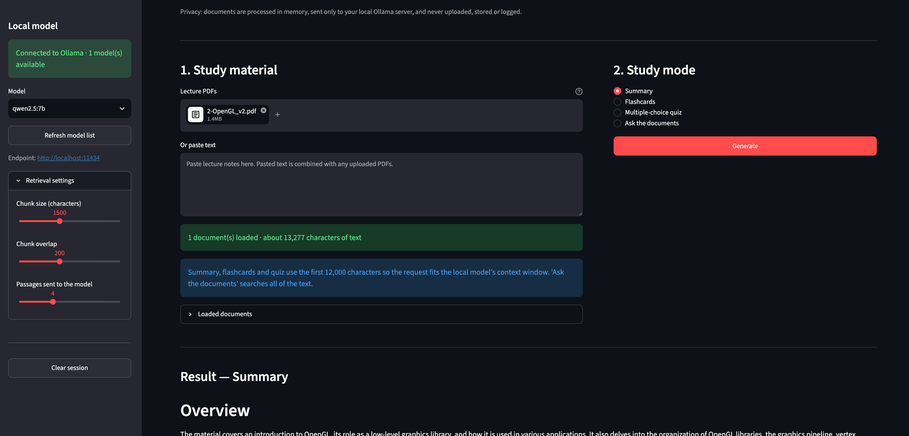
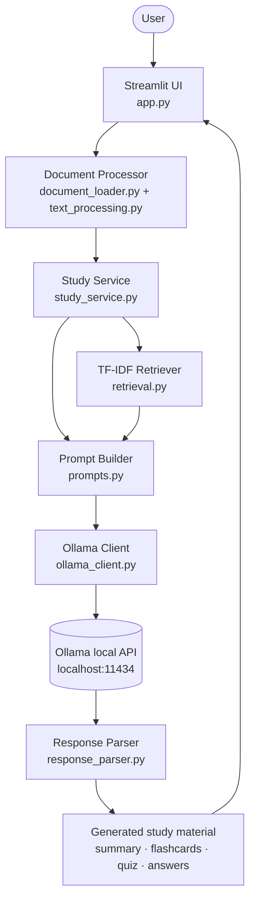

# Local AI Study Assistant

A privacy-focused study assistant that turns lecture PDFs and pasted notes into summaries,
flashcards, practice quizzes and grounded answers — using a language model that runs **entirely on
your own machine** through [Ollama](https://ollama.com).

No API keys, no cloud services, no database, no tracking. Once Ollama and the Python dependencies
are installed, the application costs nothing to run and works offline.

---

## Features

| Mode | What it does |
| --- | --- |
| **Summary** | A structured revision summary: overview, key concepts, important definitions, and a review checklist. |
| **Flashcards** | Question-and-answer cards generated as JSON, shown with hidden answers, downloadable as JSON or Markdown. |
| **Multiple-choice quiz** | 5, 10 or 15 questions with exactly four choices, a validated correct answer and an explanation. Answers stay hidden until you expand them. |
| **Ask the documents** | Question answering over your material using TF-IDF retrieval, with the retrieved passages and their similarity scores shown on request. |

Supporting features:

- Upload several PDFs at once, paste text, or combine both.
- Clear handling of encrypted PDFs, unreadable files and scanned pages with no extractable text.
- Live Ollama connection status and a selector for any model you have installed.
- Explicit error messages when Ollama is not installed, not running, or has no model.
- Download buttons for every generated result.
- One-click session clearing.

---

## Screenshot



A lecture PDF loaded and summarised entirely on-device. The sidebar shows the live Ollama
connection, the selected local model and the retrieval settings; the main panel reports how much
text was extracted and warns when whole-document modes truncate it.

> If you capture your own, check the window first: `.gitignore` excludes PDFs and generated study
> files, but it does not filter images, so private or copyrighted course material in a screenshot
> would be committed.

---

## Technology stack

| Layer | Choice | Why |
| --- | --- | --- |
| Interface | Streamlit | Pure Python UI, fast to build, easy to read in an interview. |
| Language model | Ollama (local HTTP API) | Runs on-device; no API key, no cost, no data leaving the machine. |
| HTTP | `requests` | One well-understood dependency instead of a heavyweight SDK. |
| PDF extraction | `pypdf` | Pure Python, no system binaries needed. |
| Retrieval | `scikit-learn` TF-IDF + cosine similarity | Lexical search with no embedding model and no vector database. |
| Tests | `pytest` | Fast unit tests, no network and no model required. |
| Linting | `ruff` | Linter and formatter in one tool. |
| CI | GitHub Actions | Runs lint and tests on every push and pull request. |

Deliberately **not** used: OpenAI/Anthropic/Gemini APIs, LangChain, LlamaIndex, any database,
authentication, Docker, and any form of analytics or telemetry.

---

## Architecture



Every arrow stays on your machine. `localhost:11434` is the only network endpoint the application
ever contacts.

A longer walkthrough of each stage is in [docs/architecture.md](docs/architecture.md).

---

## How the lightweight TF-IDF retrieval works

"Ask the documents" is retrieval-augmented generation without an embedding service:

1. **Chunk** — each document is split into overlapping chunks (≈1,500 characters with 200
   characters of overlap) that end on paragraph or sentence boundaries where possible.
2. **Vectorise** — `TfidfVectorizer` builds a term-frequency / inverse-document-frequency matrix
   over those chunks, using English stop-word removal and word bigrams.
3. **Rank** — your question is projected into the same vector space and scored against every chunk
   with cosine similarity.
4. **Select** — the top *k* chunks (default 4, configurable in the sidebar) are kept. Chunks with a
   score of zero share no term with the question and are discarded.
5. **Ground** — only those chunks are sent to the model, wrapped in delimiters, with instructions to
   answer *only* from them and to reply "The answer was not found in the provided documents" when
   they are insufficient. If retrieval returns nothing at all, that answer is returned without
   calling the model.

**This is lexical keyword matching, not semantic embedding search.** TF-IDF compares the words that
actually appear in the text. A question phrased with different vocabulary than the source material
("CPU scheduling" vs. "processor allocation") will match less well than it would with a semantic
embedding model. The trade-off is deliberate: no embedding download, no vector database, no cost,
and retrieval that is easy to explain and to debug.

---

## Requirements

- macOS (Apple Silicon or Intel), Linux or Windows — the setup below is written for macOS.
- Python 3.11 or newer.
- [Ollama](https://ollama.com/download) installed, running, and with at least one model pulled.
- About 3–5 GB of free disk space for a small model.

---

## Setup on macOS

### 1. Install Python (if you do not have 3.11+)

```bash
brew install python@3.12
python3 --version
```

### 2. Get the project and create a virtual environment

```bash
git clone https://github.com/abdeljalilsennaoui/local-ai-study-assistant.git
cd local-ai-study-assistant

python3 -m venv .venv
source .venv/bin/activate
pip install --upgrade pip
pip install -r requirements-dev.txt
pip install -e .
cp .env.example .env
```

Or do all of that in one step:

```bash
make setup
```

### 3. Install and start Ollama

Download the macOS app from [ollama.com/download](https://ollama.com/download) and launch it once.
Launching the app starts the local server automatically, so no separate command is needed.

Homebrew works too:

```bash
brew install ollama
ollama serve                 # leave this running in its own terminal tab
```

> **On Apple Silicon, check which Homebrew you have first.** `brew --prefix` should print
> `/opt/homebrew`. If it prints `/usr/local`, your Homebrew is the Intel build running under
> Rosetta 2, and `brew install ollama` will give you an emulated x86 binary — significantly slower,
> and without Metal GPU acceleration. Use the official download instead.

### 4. Install a model

```bash
ollama pull qwen2.5:7b       # ~4.7 GB, the recommended default

# alternatives:
ollama pull qwen2.5:14b      # ~9 GB, better output if you have the memory
ollama pull llama3.2         # ~2 GB, for machines with limited RAM
ollama pull phi3.5           # ~2 GB, the fastest option

ollama list                  # confirm what is installed
```

**Prefer a 7B model if you can afford the memory.** Flashcards and quizzes ask the model to return
strict JSON, and 3B models such as `llama3.2` and `phi3.5` fail that noticeably more often. The
application handles malformed JSON without crashing — it shows the raw response instead — but you
will regenerate more.

Any installed model appears in the sidebar selector; you can switch between them at any time.

### 5. Run the application

```bash
make run
# equivalent to: .venv/bin/python -m streamlit run app.py
```

Streamlit opens `http://localhost:8501` in your browser.

---

## Running tests

```bash
make test
# equivalent to: .venv/bin/python -m pytest
```

The tests mock every HTTP call, so they run without Ollama, without a network connection and
without any external PDF.

## Running the linter

```bash
make lint      # ruff check + format check
make format    # apply formatting and safe fixes
make check     # lint and test together, the same as CI
```

---

## Configuration

All settings are optional environment variables, read from `.env` or the shell:

| Variable | Default | Purpose |
| --- | --- | --- |
| `OLLAMA_BASE_URL` | `http://localhost:11434` | Where the local Ollama server listens. |
| `OLLAMA_MODEL` | *(empty)* | Model pre-selected in the sidebar. |
| `OLLAMA_TIMEOUT` | `120` | Seconds to wait for a generation response. |

Chunk size, chunk overlap and the number of retrieved passages can be changed at runtime in the
sidebar.

---

## Project structure

```
local-ai-study-assistant/
├── app.py                          # Streamlit interface (presentation only)
├── src/local_study_assistant/
│   ├── config.py                   # Environment settings and shared constants
│   ├── exceptions.py               # Custom exceptions with UI-safe messages
│   ├── ollama_client.py            # HTTP client for the local Ollama API
│   ├── document_loader.py          # In-memory PDF and pasted-text loading
│   ├── text_processing.py          # Text cleaning and overlapping chunking
│   ├── retrieval.py                # TF-IDF indexing and cosine-similarity ranking
│   ├── prompts.py                  # All prompt text, in one place
│   ├── response_parser.py          # JSON extraction, validation and exports
│   └── study_service.py            # Orchestration: context → prompt → model → result
├── tests/                          # Unit tests (no network, no Ollama)
├── docs/
│   ├── architecture.md             # Detailed pipeline walkthrough
│   ├── portfolio-notes.md          # Interview and CV notes
│   └── screenshots/                # Images used by this README
├── .github/workflows/ci.yml        # Lint and test on every push and pull request
├── .env.example
├── Makefile
├── pyproject.toml
├── requirements.txt
└── requirements-dev.txt
```

The interface never talks to Ollama directly and contains no parsing logic: `app.py` collects input
and renders results, and `study_service.py` orchestrates everything else.

---

## Privacy

- **Documents never leave your machine.** The only network call is to `http://localhost:11434`.
- **Nothing is written to disk.** Uploads are processed as bytes in memory; there is no database,
  no cache directory and no upload folder.
- **No analytics, no telemetry, no tracking.**
- **Logs stay minimal.** The application logs file names, sizes and counts — never document
  contents.
- **Errors are summarised, not dumped.** The interface shows a readable message instead of a stack
  trace, and error messages use file names rather than full local paths.
- **Generated study material is git-ignored** so private course content cannot be committed by
  accident.

The one thing to keep in mind: Streamlit's file uploader buffers uploads in memory for the duration
of the session, and Ollama may keep the model loaded in RAM after a request. Both are local to your
machine.

---

## Current limitations

- **No OCR.** Scanned or image-only PDFs contain no extractable text and are rejected with a clear
  message.
- **Lexical retrieval only.** TF-IDF matches words, not meaning; a question that uses different
  vocabulary than the source text may retrieve poorly.
- **Whole-document modes are truncated.** Summaries, flashcards and quizzes use the first ~12,000
  characters of the combined material so the request fits a typical local context window. The
  interface reports when truncation happens. Retrieval-based answering is not affected.
- **Output quality depends on the model.** A small local model produces weaker material than a large
  hosted one, and may occasionally return malformed JSON — the app shows the raw response instead of
  crashing. The smaller the model, the more often this happens.
- **No persistence.** Closing the browser tab discards the session; that is a privacy decision, not
  an oversight.
- **Single user, local only.** There is no authentication, and the app is not intended to be exposed
  to a network.

## Possible future improvements

- Optional OCR for scanned PDFs (for example via Tesseract), kept opt-in and local.
- Optional local embedding retrieval through Ollama's `/api/embeddings`, with TF-IDF as the
  fallback, and a comparison of the two.
- Streaming responses so long generations appear progressively.
- Map-reduce summarisation over chunks instead of truncating long documents.
- Spaced-repetition export (Anki-compatible CSV).
- An interactive quiz mode that scores your answers.

---

## License

Released under the [MIT License](LICENSE) © 2026 Abdeljalil Sennaoui.
